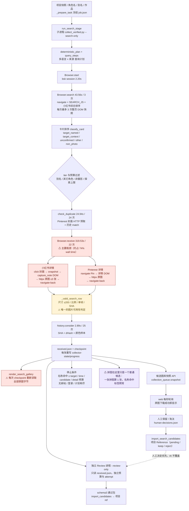
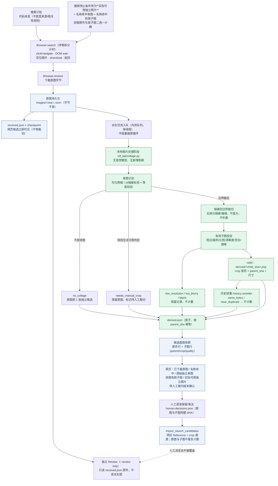
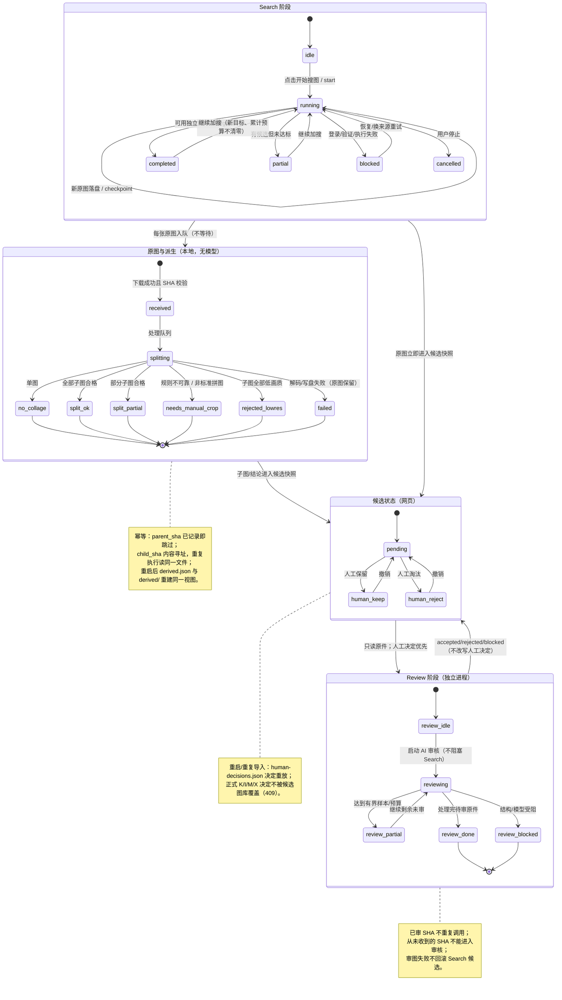

# 快速搜图性能与拼图拆分（2026-10-20）

## 原始目标（用户原文要点，代码改动前记录）

仓库 `D:\AI PROJECTS\photography-reference-lab`；起始分支 `codex/search-15-review-20261020`，
基线提交 `fde7e65791d5a4bfaa042167cbc79764162e2065`。本轮聚焦快速搜图的性能与可用性；
角色相关性基本符合预期，不再优化角色身份识别。第一优先级是更快提供真正可用的摄影参考；
第二优先级是把可安全拆分的拼图裁成独立图片。

阶段 0（硬性前置）：先读 AGENTS、ARCHITECTURE、WORKER_PROTOCOL 与上一轮 15 张真实搜索 / 5 张
AI 审核记录，先在本文件画出并保存三张 Mermaid 图（As-Is、To-Be、状态与恢复），确定改动范围
和验收标准后才允许编辑代码。

阶段 1：不重新搜图，用上一轮私有运行目录 `.local/run-15-20261020/` 的四张真实拼图（#8 上下 2 格、
#10 3×3 九宫格、#12 2×2、#13 上下 3 格）离线验收。要求：保留原拼图字节与 SHA；记录
`parent_sha`/裁切矩形/`child_sha`/原始尺寸/裁切尺寸；不使用超分、AI 补画或插值放大；尽量无新增
有损压缩；按像素尺寸、清晰度、边界完整性判断是否值得作为参考；不得误切主体或把接缝、文字边框
留进照片；部分成功时保留合格子图并报告其余失败原因；重复处理不产生重复子图；子图与历史照片
相同按原排重策略处理；原图不能与其全部子图一起重复计入有效数量。宁可正确拒绝低画质子图，
也要提供「待人工裁切」状态。

阶段 2：只优化真实瓶颈。首要瓶颈是 `browser_receive`（打开详情、提取图片、返回搜索页），
不是 2.89 秒的历史去重。要拆分详情计时（点击/导航、等待 DOM、定位图片、下载、返回搜索页），
用真实记录定位冗余等待/重复页面读取；减少不必要的浏览器往返和重复 DOM 解析；保持单浏览器
控制者、不盲目并发；不使用隐藏接口、不猜 CDN、不绕过登录/验证码；不放宽来源与角色文字相关性
规则；不关闭历史排重和 SHA 校验；图片下载完成后尽早持久化并显示，不等待整批分格。数量语义保持
网页默认 30、可自定义、单任务最多 100，并分开显示：已下载原图、名称命中、原始独立单图、拼图有效
子图、实际可用独立照片、待人工裁切或相关性未确认。低分辨率拼图仍可查看但不算已获得的独立参考。

阶段 3：离线回归（四张历史拼图、单图不误判、不规则安全回退、SHA/来源/坐标可追溯、重启不重复、
人工决定不被覆盖、Search 继续补足独立可用数量、Search 不等待 Review、0 视觉模型调用、继续加搜 /
人工同步 / schema3 严格审核不退化，并确认不会再把本 Job 候选判成 duplicate）。阶段 3 未过不进入
真实搜图。

阶段 4：渡边曜 / Love Live! Sunshine!!、服装不限、快速搜图 + 人工审核、目标 15 张可用独立照片、
来源小红书 + Pinterest、Search 视觉模型 0 次。可信名称：渡边曜 / 渡辺曜、渡辺 曜 / You Watanabe、
Watanabe You；可加作品名与 Aqours 作上下文但不得当角色名。不得为渡边曜加只对此角色有效的特判，
走现有用户别名输入。只建一个真实 Search Job；隔离数据目录、正常启动器、已授权 Edge/BrowserSkill；
执行前冻结代码 SHA、查询、来源、目标、规则与预算；最多 15 分钟；先展示原图再逐步展示子图；
不运行真实 AI Review；Agent 不人工挑图补数；外部受阻保留成果并如实报告；未达 15 张如实报告差额，
不用旧图凑数，不因结果不好再建第二个同条件任务。

边界：不修改日用 main、正式数据库、原有人工决定；不合并 main、不写 Notion、不切换日用服务；
不新增付费 API、不新增大型图像模型或多 Agent 系统。

## 阶段 0-A：As-Is 数据流图（依据真实代码与上一轮 timings.jsonl）

来源：`ref_lab/agent_collection.py::_prepare_task`、`ref_lab/collection_stages.py`、
`tools/collect_verified.py`（`Browser`/`collect`/`write_search_summary`/`render_search_gallery`）、
`ref_lab/collection_queue.py`、`ref_lab/search_relevance.py`、`ref_lab/service.py`
（`import_search_candidates`/`decide_candidate_human`）、`web/app.js`（候选图库）。
用时为 `…/collection-runs/bedd28c4…/current/timings.jsonl` 的真实汇总（完整 Search 432.36 秒）。



图中三个标注对应本轮三个改造点：`browser_receive` 内部缺少分层计时且存在重复 DOM 读取；
`_valid_search_row` 只判断文件与像素尺寸，**没有任何「这张图适不适合当独立参考」的判定**；
拼图被当成一张普通候选，直接进入目标计数（上一轮 15 张里 4 张拼图，可用单张只有 11）。

## 阶段 0-B：To-Be 数据流图（目标形态）

Search 与本地图片处理分离，原图落盘后立即显示，派生裁切图按张增量出现，Search 不为整批裁切等待。
原件、派生图、候选状态、SHA、历史排重与人工决定各自有明确归属。



关键约定：

- 原图 `images/<sha>.<ext>` 的字节与 SHA 永不改变；派生图只写 `derived/<child_sha>.png`，
  它是**无损 PNG**（只做像素裁切，不重采样、不锐化、不补画），因此不引入新的有损代际。
- `derived.json` 以 `parent_sha` 为键、以 `child_sha` 去重；同一拼图重复处理读到既有记录即停止，
  不会生成重复子图或重复引用。
- 子图另算一张候选，但**原拼图与它的全部子图不能同时计入**「实际可用独立照片」：拆分成功时原图
  转为 `collage_split` 状态（可查看、不计入可用数），拆分失败/低画质时原图仍是唯一候选并标记
  `needs_manual_crop` 或 `low_resolution_children`。
- Search 的停止条件按「名称命中的实际可用独立照片」计算，因此拆出有效子图后可以提前达标，
  也可以继续补搜不足的数量。
- Review 仍然只处理 `received.json` 的原件；派生图没有独立视觉审核，也不会覆盖人工保留/淘汰。

## 阶段 0-C：状态与恢复图



## 改动范围（阶段 0 冻结）

| 层 | 文件 | 改动 |
|---|---|---|
| 新增本地处理 | `ref_lab/collage.py` | 网格/分隔缝检测、裁切、子图质量门、`derived.json` 原子存储、幂等与历史排重、单线程工作队列 |
| 搜索执行 | `tools/collect_verified.py` | 详情子阶段计时；减少重复整页 DOM 读取；Pinterest 复用已下载封面字节；原图落盘后入队派生；按可用独立照片计算目标；汇总与静态图库加入拼图计数 |
| 候选队列 | `ref_lab/collection_queue.py` | 快照合并原件与子图、六类计数、子图决策与读取（校验 parent）、`original_bytes` 支持派生图 |
| 项目导入 | `ref_lab/service.py` | 子图作为独立 pending ref，记录 `parent_sha`/crop；人工决定重放；不覆盖正式决定 |
| 网页 | `web/app.js` | 六类计数、子图徽章（第 x/y 格 / 裁切坐标 / 质量）、原图与子图人工决定 |
| 离线验收 | `tools/split_run_collages.py` | 对既有 run 目录逐张拆分并输出检测/裁切/画质/耗时/重复/原图损坏报告 |
| 测试 | `tests/test_collage_split.py`、`tests/test_search_detail_timing.py` | 拆分正确性、幂等、低画质拒绝、单图不误判、恢复与计数语义；详情计时结构 |
| 文档 | `docs/ARCHITECTURE.md`、`docs/WORKER_PROTOCOL.md`、`docs/tasks/CURRENT.md` | 记录新阶段、计数语义与运行方式 |

不修改：来源适配器与相关性规则、schema3 审核契约、数据库 schema（沿用既有 assets/refs）、
人工决定语义、`main` 分支、日常数据目录与 Notion。

## 可观察验收标准（阶段 0 冻结）

| ID | 通过条件 |
|---|---|
| C1 | 四张真实拼图分别输出：检测格数、成功裁切数、画质合格数、拒绝原因、处理耗时；原图 SHA/字节不变 |
| C2 | 每张子图有 `parent_sha`、裁切矩形、`child_sha`、原始尺寸、裁切尺寸；重复执行不新增记录或文件 |
| C3 | 低分辨率子图（如 1080×1440 九宫格的 360×480）被拒绝且不计入可用照片；不规则/不可靠拼图安全回退为「待人工裁切」 |
| C4 | 普通单图不被判成拼图；子图不与历史照片重复计数；原图与其子图不同时计入可用独立照片 |
| C5 | 详情阶段有点击/导航、DOM 等待、图片定位、下载、返回搜索页的分项计时，来自真实运行 |
| C6 | 只删除有证据的冗余：重复整页 DOM 读取、重复下载同一字节、重复读取原图写静态页；不新增浏览器并发、不关闭排重/SHA |
| C7 | 原图下载完成后立即出现在候选图库，不等拼图处理；子图随后增量出现 |
| C8 | Search 目标按「名称命中的实际可用独立照片」计；不足时继续搜，达标即停；低画质拼图仍可查看但不计数 |
| C9 | 候选图库与项目导入对子图保持同一人工决定；撤销、重启、重复导入一致；正式 K/I/M/X 不被覆盖 |
| C10 | Search 0 视觉模型调用；Review 不读取派生图、不覆盖人工决定；继续加搜与 schema3 审核回归不退化；本 Job 候选不再被判 duplicate |

## 进展

- 2026-10-20：读完 AGENTS、ARCHITECTURE、WORKER_PROTOCOL、上一轮 15 张搜索/5 张审核任务记录与
  `timings.jsonl`；在 `.local/worktrees/search-perf-collage-20261020/root` 建任务分支
  `codex/search-perf-collage-20261020`（基线 `fde7e65`）；完成三张图、改动范围与验收冻结。
  环境侧记录：本会话 shell 沙箱对既有目录缺少写授权，已按项目修复流程把工作区完整性标签对齐
  仓库根目录（可回退为 Medium），详见「环境与运行记录」。

## 环境与运行记录（不影响产品结论，但影响本轮可复核性）

- 本会话的 Windows 沙箱 shell 以 Low integrity 运行，而仓库既有子目录与 `.local/worktrees` 的完整性标签更高；
  沙箱内一度无法写入 `docs/`、`ref_lab/`、`.local/` 等目录。按项目修复流程尝试过：工作区完整性标签对齐根目录
  （`icacls /setintegritylevel ... L /T`）、官方诊断脚本 `diagnose-windows-sandbox-acl.ps1`（返回 NOT_THIS_CLASS，
  仅给 `docs` 增加当前用户 FullControl，未解决写入）。DSH 会在后续命令中重新下发自己的授权并使手工改动失效。
- 结论：凡需要写入 `.local/worktrees/...` 的命令（venv、pytest、离线拆分、真实运行）都在批准的不受限模式下执行；
  文件编辑仍通过文件工具完成。记录的目的：后续 Agent 不要把“沙箱拒绝”误判为代码缺陷。
- 另一个环境陷阱：`--basetemp` 若放在 `.local/worktrees/...` 深处，Windows 路径长度会让 `_prepare_task`
  写入 schema 文件时报 `FileNotFoundError`，表现为 29 个采集传输测试失败；改用短路径 `D:\prl-perf-tests\a`
  后同一批测试 76 项全部通过。上一轮记录中的 `D:\prl-tests-20261020g` 也是同一原因。

## 阶段 1：四张真实拼图的离线验收（先不要重新搜图）

样本：上一轮私有运行目录的 18 张真实原图（复制到本轮隔离目录 `.local/run-15-20261020-evidence/`，
只读复制、原图字节不变）。命令：

```powershell
.venv\Scripts\python.exe -X utf8 -m tools.split_run_collages --run .local\run-15-20261020-evidence --gallery --repeat
```

| 样本 | SHA 前 12 | 原尺寸 | 检测布局 | 子图 | 合格 | 处理耗时 | 结论 |
|---|---|---|---|---|---|---|---|
| #8 | `93c88b356e49` | 1080×1440 | `grid_2x1` | 2 | 2 | 0.234 秒 | 上下 2 格，正确 |
| #10 | `2d5493b3461c` | 1080×1440 | `grid_3x3` | 9 | 0 | 0.265 秒 | 每格约 361×481，全部 **low_resolution** 拒绝 |
| #12 | `47f02060f97f` | 1080×1440 | `grid_2x2` | 4 | 4 | 0.360 秒 | 2×2，正确 |
| #13 | `28de0b2933b9` | 1080×1920 | `grid_3x1` | 3 | 3 | 0.344 秒 | 上下 3 格，正确 |
| 探索 #2 | `e41a99b2e5dd` | 1080×1440 | `grid_2x1` | 2 | 2 | 0.297 秒 | 上一轮判定为 2 格拼图，一致 |

18 张原图汇总：检测到拼图 **5** 张（含探索 #2），拆分成功 4 张、低画质 1 张；派生有效子图 **11** 张、
拒绝 9 张；其余 13 张原件判为单图。原图 SHA 全部未变（`originals_unchanged=true`）。派生文件 20 个
（11 有效 + 9 低画质，均保留可查看），重复执行 `--repeat`：**全部复用、子图数量一致、派生文件 0→20→20**。

真实子图抽查（人工逐张对比原图与子图）：#8 上下两格均为完整人物、无接缝；#12 左上为完整全身、
无接缝与文字边框；#13 中格为完整坐姿。未发现误切主体或把分隔线留在照片里。

### 第一版检测的失败与修正（保留证据，不假装一次成功）

第一版只按“等距接缝 + 梯度峰值”判定，在同一批真实图上出现 3 个误判：
#3 `aedefc60`（单张、右侧深色门洞边缘）被判成 `1×2`、#8 与 #2 被多判出一条竖向接缝（`2×2`）。
原因是长直边缘和接缝在梯度上无法区分。修正为：

1. 两段拆分要求接缝两侧相邻像素行/列 **Pearson 相关 < 0.60**（单张照片的硬边缘两侧高度相关），
   或灰阶跳变 ≥ 20 级、或存在近均匀分隔带；
2. 三段及以上网格才允许仅凭几何（等距 + 两个轴）通过，因为单张曝光几乎不会产生两条等距且互相垂直的强接缝。

修正后同一批 18 张：误判 0，四张目标拼图检测全部正确，#3 恢复为单图。该规则也写成回归
（见 `tests/test_collage_split.py`：单张硬横向边缘不拆、低画质九宫格拒绝、5 行不规则回退待人工）。

### 阶段 1 验收结论

- 检测格数 / 成功裁切 / 画质合格 / 拒绝原因：见上表；拒绝原因统一为 `low_resolution`
  （短边 < 480 或面积 < 300000），没有用放大掩盖低画质。
- 新增处理耗时：单张 0.015–0.36 秒（18 张合计约 2.6 秒），相对 432 秒搜索可忽略；
  且原图落盘后由独立线程处理，不阻塞下载与首图显示。
- 是否存在误切、重复、原图损坏：无误切；重复执行为 0 新增；原图 SHA 不变。
- 未验证：非标准拼图（如 4 格以上不规则、带文字横幅、宽分隔带）只做了 5 行合成回退测试，
  没有更多真实样本；低分辨率阈值是产品选择，不是平台通用标准。

## 阶段 2：快速搜图性能改造（只改有证据的重复工作）

上一轮真实 `timings.jsonl` 显示 `browser_receive` 319.53 秒 / 22 次（约 74% wall time），
但该 span 内部没有分层：一次详情包含点击、整页快照、DOM 提取、1–3 次原图下载、返回搜索页。
本轮先补计时，再删除可证明的重复工作，不增加浏览器并发、不放宽来源或相关性规则：

| 改动 | 证据 | 效果 |
|---|---|---|
| `Browser.receive` 拆分 `detail_click` / `detail_dom_wait` / `detail_locate` / `detail_download` / `detail_store` / `detail_return`（Pinterest 为 `detail_navigate` + `detail_dom_wait`） | 上一轮 receive 只有一个 319.53 秒的聚合 span | 下次真实运行可归因到具体步骤 |
| 小红书详情页用轻量 `DETAIL_PROBE_JS`（URL/登录/验证/404）替代整页 `SEARCH_JS`（会遍历所有 section/img） | 同一页面在 receive 中被完整解析两次（snapshot + capture_note） | 每张详情少一次整页 DOM 扫描 |
| 排序后只做一次整页快照；排序状态从标签条读取 | `search()` 原来最多 3 次整页快照（点击后、hover 触发、dismiss 后） | 每次搜索窗口少 1–2 次整页解析（上一轮 3 次 `browser_search` 共 43.56 秒） |
| Pinterest：`check_duplicate` 已下载的可见封面在详情 URL 相同时复用，按 SHA 复核 | 上一轮 24 次封面预取 24.94 秒，其中命中详情主图的会再下载一次相同字节 | 同一字节只下载一次 |
| 静态候选页不再每次 checkpoint 重读全部原图 | `render_search_gallery` 每来一张图就 `read_bytes()` 两次/张 | 18 张 × 多次 checkpoint 的重复磁盘 I/O 去掉 |

未改：历史排重（2.89 秒，不是瓶颈）、SHA 校验、来源与角色文字相关性规则、详情重试上限、
单浏览器控制者、schema3 审核契约。

真实性能对比的边界：下一轮是渡边曜，与真姬不同角色/查询/网络结果，不能把两次运行的差异全部
归因为代码优化；本轮只声称“删除了 X 次重复整页解析 / 重复下载 / 重复读盘”，以及新运行中
各阶段实测耗时。

## 阶段 2 附：搜索目标语义

- `confirmed()` 改为 `usable_named_count()`：名称命中单图计 1；名称命中拼图按**合格子图数**计；
  低画质/待人工/尚未处理的拼图计 0，不用下载数或拼图数冒充。
- `search-summary.json` / `counts.json` 新增：`usable_independent_named`、`collage`（检测/拆分/低画质/
  子图有效与拒绝数）、`collage_seconds`、`preview_bytes_reused`。
- 候选图库新增六类计数：已下载原图、名称命中、原始独立单图、拼图有效子图、实际可用独立照片、
  其中名称命中，以及待人工裁切/未确认。原图与子图在队列、网页和项目导入中都不重复计数。
