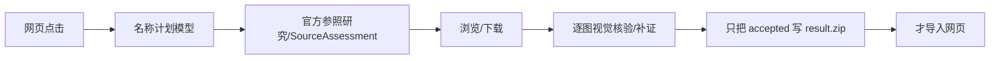
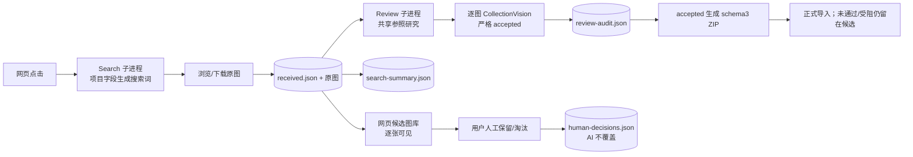

# 搜图与审核解耦：快速 Search / 独立 Review

## 原始目标（编辑前记录，保留用户原文）

用户要求把现有一体式搜图任务拆成两个独立阶段：

- **A. Search / Acquire（快速搜图）**：按角色、作品、服装和目标数量生成搜索词；使用现有小红书、Pinterest 等合法浏览能力；抓取原图并保存来源 URL、搜索词、原帖信息、原图 SHA 和可用元数据；做低成本文件有效性检查和去重；图片下载成功后立即持久化并展示在网页候选图库；持续搜索直到达到候选目标、预算耗尽或来源阻断。
- Search 阶段禁止同步等待：官方角色图考证、SourceAssessment、可信来源认证、高成本视觉模型身份验证、needs_supplement 补证。角色缺少中日英别名时先用已有项目字段查询，不得因昂贵名称调查阻塞第一轮搜索。历史排重保留，但不得因每轮全量重建指纹拖慢首次结果；可复用缓存，必要时后台补充昂贵视觉指纹；未经验证的重复图片不得自动进入正式准入库。Search 成功只表示图片已成功获取，绝不等于通过摄影审核。
- **B. Review（独立审核）**：用户可选择人工审核或 AI 自动审核；AI 可使用现有视觉模型、官方参照调查、角色和服装核验、完整补证流程；模型及执行器允许未来配置替换；同一角色共享可信参照和缓存；每张图片独立更新审核状态并给出依据；审核失败、超时或来源不足时保留候选原图并标记审核受阻，不回滚 Search 成果。必须保留原有严格 accepted、schema3 和角色身份验证规则；禁止把“未经审核”标为“已验证”，禁止降低身份核验要求制造高通过率。
- **网页交互**：新增“快速搜图”和“搜图 + AI 审核”两个清楚模式。快速模式点击后立即 Search，搜索中可浏览已下载候选，搜索完可手动审核，也可稍后启动 AI 审核而不重新搜索。搜图 + AI 审核模式点击后同时启用 Search 和独立 Review 消费队列；Search 不等待 Review；审核完成图片逐步标记通过/拒绝；审核超时不能阻塞继续搜索或显示新候选；即使 0 张通过，网页仍保留本轮已获取合法候选并准确显示 0 通过。搜索中即可出现候选缩略图和打开原图入口，不得等整轮 ZIP。界面明确区分已找到候选数、已通过、审核拒绝、尚待审核、审核受阻；搜索完成状态与审核完成状态分别记录。搜索成功而审核失败不是整个任务一无所获。
- **工程边界**：优先复用原采集器、原图存储、候选数据、UI、审核器、恢复机制；新增尽可能薄的持久候选队列和阶段状态；不得默认通过新增多个 Agent、多层管理器、更多模型调用解决问题；搜索和审核独立性首先由程序状态机与持久队列保证。保持不变量：原图只保存一次且审核读取同一原图 SHA；重启后已搜图片仍在、已完成审核不重复调用；人工决定不能被 AI 静默覆盖；审核取消不停止 Search、Search 停止不丢失候选；审核重试遵守原额度和身份绑定；未审核图片不进入正式“已验证”集合但可在独立候选视图中使用；不改变现有摄影模型提示词和准入标准。
- **验证**：离线替身和隔离数据优先：将 SourceAssessment 故意阻塞 10 分钟证明 Search 仍能下载和展示新图；视觉模型故意报错证明候选不消失；中途重启证明 Search/Review 分别恢复；重复启动审核证明原图与已完成判断不重复；证明人工决定不被覆盖；证明原四张成功样本审核判断一致。然后仅一次小规模真实验收：快速模式搜索 4–6 张候选原图，不启用 AI 审核；从正常 Windows 网页入口启动；记录点击到首张真实原图网页可见时间、获取 4 张不同有效候选时间、网页搜索和图片下载分别耗时、该阶段模型调用次数与 Token、重开后持久性、登录/访问限制/实际下载错误。本轮不得再启动 20 张完整真实审核，不得因结果不佳增加重试预算。快速模式成功后，用离线测试或复用原真实回执验证“搜图 + 审核”数据流，不必立即第二次付费外网实跑。
- **工作边界**：从最新工程分支创建独立工作树和分支；4/4 成功基线仅对照不覆盖；不改日用 main、正式图片库和人工数据；不合并 main、不写 Notion；不引入新服务商或付费 API；不扩张为全面性能优化、CI 整改或架构重建；先完成用户真实使用体验，再处理非阻塞技术债。
- **最终验收**：不是 AI 能否证明 20 张图片合格，而是即使 AI 暂时无法审核，用户依然能及时拿到真实、可查看、可继续处理的候选原图。

## 基线

- 最新工程分支：`codex/collection-finalization-20261019`，提交 `1cff011766cc5169074c89577b74175b4d0bfeec`。
- 历史成功基线：`codex/collection-supply-20261019`，提交 `02162249a040e5ba86ee7f9757659e25be2f4d56`；真实 4/4 准入，373.609 秒。
- 上次 20 图任务：5 收到、3 核验、0 准入；点击到受阻 2541.780 秒，含中断/修复；参照准备累计 674.781 秒。
- 本次独立工作树：`.local/worktrees/search-review-decouple-20261020/root`；分支 `codex/search-review-decouple-20261020`。
- 只读对照证据：`.local/worktrees/collection-performance-20261019/root/.local/supply-ui-fixed-20261019` 的四张原图、原回执、manifest 和 reference report；`.local/worktrees/collection-finalization-20261019/root/.local/finalization` 的 trial/encoding 证据。不得写回。

## 可观察验收标准（本任务）

| ID | 通过条件 |
|---|---|
| SR-01 | 快速模式点击后不调用 NamePlan / ReferenceDiscovery / SourceAssessment / CollectionVision，也不等待参照研究；首张下载原图立即进入持久候选队列和网页候选视图。 |
| SR-02 | SourceAssessment 故意阻塞 10 分钟时，Search 仍持续下载并展示新候选；Review 独立受阻不改变 Search 状态。 |
| SR-03 | 视觉模型报错/超时只把对应图片标为审核受阻；候选原图、来源、SHA 和网页条目全部保留。 |
| SR-04 | 搜索结束返回 4–6 张不同有效原图目标；即使 0 张通过审核，候选数、通过数、拒绝数、待审数、受阻数和停止原因分别准确显示。 |
| SR-05 | 服务重启后 Search/Review 分别恢复；已下载候选仍在；已完成审核不重复调用；原图 SHA 不变。 |
| SR-06 | 人工通过/拒绝持久保存，AI 审核结果不能静默覆盖；未审核图片不被标成已验证。 |
| SR-07 | 原四张真实成功样本的原图、原回执和 accepted 判断保持一致；摄影提示词、accepted、schema3、角色/服装核验规则未改。 |
| SR-08 | 只做一次小规模真实快速搜图（4–6 张、不启用 AI 审核），正常 Windows 网页入口，记录首图/4 图耗时、阶段耗时、模型调用/Token、重开持久性和访问限制。 |

## 边界

- 不改日用 main、正式数据库、人工 K/I/M/X 决定、历史原图和回执。
- 不合并 main、不写 Notion、不新建付费 API、不启动 20 图完整真实审核。
- 不改变摄影提示词、accepted、schema3、身份/服装核验和补证门槛。
- 搜索阶段不用高成本视觉模型；审核阶段复用现有模型与参照研究。
- 真实小样本若受阻，如实记录，不无限重试、不用旧图凑数。

## 进展

- 2026-10-20：已读取两个基线分支任务记录、collector/verified_collection/service/API/UI 与四图对照证据；创建独立工作树和分支。开始实现持久候选队列与阶段状态。

## 实现

新增 `ref_lab/collection_stages.py` 作为阶段状态机，新增 `ref_lab/collection_queue.py` 作为只读候选队列/人工决定投影；没有新增 Agent 或多层管理器。Search 和 Review 都复用 `tools/collect_verified.py`、既有 BrowserSkill 采集、原图目录、参照研究、CollectionVision、accepted、schema3 和恢复机制。

- Search：`collect_verified.py --search-only`，用 `deterministic_plan` 从项目已有角色/作品/服装字段生成搜索词，不调用 NamePlan/ReferenceDiscovery/SourceAssessment/CollectionVision/needs_supplement。下载后立即写 `received.json`；达到目标/预算/来源阻断后写 `search-summary.json`。服务端把已下载原图导入项目为 pending 候选。
- Review：`collect_verified.py --review-only [--wait-search]`，独立消费 `received.json`；先共享一次参照研究，再逐图审核，逐图写 `review-audit.json`；只有 accepted 生成 schema3 `review-result.zip` 并导入。Search 进程不读取 Review 状态、不等待 Review。
- 阶段字段：Job 增加 `collection_mode`、`search_state/search_counts/search_stop_reason/search_summary`、`review_state/review_counts/review_stop_reason/review_summary`、独立 attempt id/process owner/累计预算。`/api/jobs/{id}/start|search|review|review/cancel|search/cancel|candidates|.../decision` 提供两个模式和候选图库。旧 `verified` 模式保留供历史任务/回归。
- 原图只保存一次；Review 读取同一路径并校验 SHA。人工决定写 `human-decisions.json`，优先级高于 AI；导入器拒绝把人工淘汰项写进正式包。未审核/审核受阻原图只进入候选视图和项目 pending 候选，不进入“已验证”。
- 排重：`ImageHistory` 改为路径/size/mtime 缓存 + 路径中 SHA 的精确集合 + 后台感知指纹。Search 不等待全量重建；Review 在准入前同步使用同一历史集合复核。实测发现并修复了懒加载漏掉历史同字节图片的问题。
- 文件级改动：`ref_lab/{collection_stages,collection_queue,collection_history,agent_collection,api,imports,models,service,verified_collection}.py`、`tools/{collect_verified,exact_recall}.py`、`web/{app.js,styles.css}`、相关文档与测试。

### 修改前后数据流

修改前（一体式，单进程内串行）：



修改后（Search / Review 两个阶段，各自持久状态）：



修改前：网页点击 → 同步 HTTP 请求内完成名称计划 → 参照研究/SourceAssessment → 浏览/下载 → 每张图立即视觉核验/补证 → 只把 accepted 写 ZIP → 才导入网页。参照或视觉变慢直接推迟首图；审核失败时已下载原图没有正常网页入口。

修改后：
1. 网页点击 → `/start` 立即返回；Search 子进程开始浏览和下载，`received.json` 每张原子更新，候选图库每秒轮询显示。
2. Search 完成 → 记录 `search-summary`，已下载原图导入项目 pending 候选；Review 可以稍后启动，不需要重搜。
3. `search_review` 模式同时启动 Review 子进程；Review 在独立锁/attempt/预算下消费新候选，Search 不等待。
4. Review 逐图写 `review-audit`；accepted 生成 schema3，人工/未审核项保持候选状态；审核失败/超时只标记受阻。

### 状态契约

- Search：`idle → running → completed|blocked|failed|cancelled`。停止原因包括 `target_reached`、`time_budget_exhausted`、`candidate_budget_exhausted`、`detail_budget_exhausted`、`sources_blocked`、`login_or_challenge`、`search_plan_exhausted`、`internal_error`、`user_cancelled`。Search 完成只表示原图已获取，不代表摄影准入。
- Review：`idle → running → completed|partial|blocked|cancelled`（`waiting_search` 是进度阶段，不覆盖 Job 状态）。停止原因包括 `review_complete`、`review_already_complete`、`review_timeout`、`reference_blocked`、`no_candidates`、`unrecoverable_review_failure`、`user_cancelled`。
- 候选：`pending → reviewing → accepted|rejected|blocked|duplicate`；人工 `human_keep|human_reject` 优先于 AI。`passed=accepted+human_keep`；`rejected_total=rejected+human_reject`；另有 `pending/blocked/found`。
- 搜索与审核的 completed/blocked 分开落盘；网页同时显示两行状态和五项数量。

## 离线验证（合成替身，不是真实视觉准确率）

工作树：`D:\AI PROJECTS\photography-reference-lab\.local\worktrees\search-review-decouple-20261020\root`。验证解释器：`C:\Users\Dell\AppData\Local\Programs\Python\Python312\python.exe`，`PYTHONPATH` 指向仓库 `.venv\Lib\site-packages`，`PYTEST_DISABLE_PLUGIN_AUTOLOAD=1`（避免外部 pytest 插件冲突）。

已运行：

```powershell
python -X utf8 -m pytest -q --basetemp D:\prl-tests-20261020 tests\test_collection_stages.py tests\test_collection_ui.py tests\test_collection_job_recovery.py tests\test_collection_runner.py tests\test_collection_history_cache.py tests\test_verified_collection.py tests\test_collection_performance.py tests\test_collection_finalization.py tests\test_collection_controller_recovery.py tests\test_collection_resume.py tests\test_collection_autonomy.py tests\test_collection_contract.py tests\test_collection_dispatch.py tests\test_collection_receipt_budget.py tests\test_collection_local_finalization.py tests\test_collection_supply.py tests\test_review_baseline_consistency.py tests\test_exact_recall.py tests\test_automatic_references.py tests\test_reference_cache.py tests\test_imports_jobs.py
```

结果：**302 passed, 1 warning**（195.36 秒；warning 为现有 Starlette/httpx 弃用提示）。

更广泛的选择性回归（collection、四图、Search/Review、imports、个人图库、操作/恢复、库浏览、真实 Chromium UI、浏览器、Windows 运行时等；不含学习/课程/Atlas 等无关域）：

```powershell
python -X utf8 -m pytest -q --junitxml=.local\acceptance-20261020\final-regression.xml --basetemp D:\prl-final-tests-20261020 tests\test_collection*.py tests\test_verified_collection.py tests\test_review*.py tests\test_imports_jobs.py tests\test_personal_library.py tests\test_operations.py tests\test_library.py tests\test_library_browser*.py tests\test_ui_components.py tests\test_browser.py tests\test_windows_runtime_scripts.py tests\test_candidate_pipeline.py tests\test_collect_adapter.py tests\test_evidence_boundaries.py tests\test_collector_boundary_regressions.py tests\test_field_guide.py tests\test_confirmed_archive.py tests\test_data_safety.py tests\test_state_convergence.py tests\test_runtime_convergence.py
```

结果：**592 passed, 2 warnings**（608.89 秒；两项均为现有依赖/模型字段 warning，不是失败）。随后把合成 Review 替身改为在首张 `received.json` 出现后即可阻塞，再单独重跑 `tests/test_collection_stages.py`：**12 passed**（12.63 秒，`.local/acceptance-20261020/stage-after-live-wait.xml`）。

新增专项证据：

- Search 不调用 NamePlan/参照/视觉：`test_search_only_persists_candidates_without_any_model_or_reference_call`、`test_search_only_cli_writes_summary_without_a_model_budget_or_result_zip` 通过；Search 0 model calls/0 tokens，不生成 result.zip。
- SourceAssessment 阻塞/Review 独立：`test_stage_endpoints_keep_search_complete_while_review_is_blocked` 通过；Review 停在 `reference_prepare` 时 Search 已完成并显示候选；释放后才审核。
- 视觉报错：`test_vision_error_marks_only_that_candidate_blocked_and_keeps_originals` 通过；只标记一张 blocked，原图/候选保留，接受部分正常导入。
- 重启/恢复：`test_partial_search_exit_keeps_originals_and_a_second_search_continues_the_same_job`、`test_queue_survives_a_new_server_process_and_human_decision` 通过；部分 Search 退出后同 Job 继续，候选 SHA 不丢；新 App 仍读到候选和人工决定。
- 审核幂等/重试：`test_review_is_idempotent_and_does_not_repeat_completed_judgments`、`test_blocked_review_retries_only_unfinished_images` 通过；第二次启动已完成项 0 视觉调用，受阻项只重试未完成图。
- 人工决定：`test_human_decision_is_not_overwritten_by_ai_review`、`test_human_reject_after_ai_accept_is_excluded_from_the_formal_package`、UI 候选队列人工保留/撤销测试通过；AI 跳过人工项，人工淘汰不进入 schema3。
- 取消审核：`test_cancelling_review_does_not_stop_search_or_delete_candidates` 通过；Search 继续至完成，候选保留。
- 四图基线：`tests/test_review_baseline_consistency.py` **2 passed**；4 张原图 SHA、原回执、`accepted`、schema3 打包 4/4 一致，0 新模型调用。
- 真实 Search 输出的离线 Review 数据流：`tests/test_review_real_search_output.py` **1 passed**；把最终 4 张真实原图复制到隔离目录，用明确标注的合成视觉判断走完整 Review，得到 4/4 schema3、原字节 SHA 一致；该测试不代表真实视觉准确率，只证明 Search→Review 数据流。

UI/JS：`node --check web/app.js` 通过；`test_collection_ui.py` 含新模式/候选图库/人工决定测试通过；`test_ui_components.py` 与 `test_browser.py` 的旧任务包下载/导入路径改为显式 legacy job 后通过。

## 真实小样本验收（仅一次最终验收，不启用 AI 审核）

环境：独立工作树自己的 `.local/windows-runtime.json`，数据目录 `.local/ui-data-quicksearch-20261020`，端口 18786，经 `scripts/launch.ps1` 启动；网页用正常 `http://127.0.0.1:18786/`，采集仍走已连接的 Windows Edge/BrowserSkill。项目角色“西木野真姬”，作品“Love Live!”，不限服装；目标 4；模式 `search`；未启动 AI 审核。

最终任务 `549b320fa82343e9911d5f1c4a919c42`：

| 指标 | 实测 |
|---|---|
| 点击“开始搜图”到首张原图下载完成（服务端） | **61.375 秒** |
| 点击到首张网页缩略图可见 | **75.415 秒**（含后台标签页轮询/缩略图延迟） |
| 点击到第 4 张候选可见 | **129.420 秒** |
| 点击到网页显示“搜索完成” | **129.431 秒** |
| Search 自身 elapsed | **115.579 秒** |
| 找到/去重/错误 | 4 / 2 / 0 |
| 模型调用 / Token | **0 / 0** |
| 历史精确集合 | 1259 个 SHA，后台感知索引已 ready，0 errors |
| 来源 | 小红书查询可用但 0 保留；Pinterest 查询保留 4；两来源均 usable |
| 登录/验证码/下载错误 | 无；2 个 Pinterest 预览命中历史近似重复，未进入下载 |
| 原图 | 4 个不同 SHA，均不在四图成功基线中；人工打开均为真人 cosplay 独立照片 |
| 重开持久性 | 服务重启 + 页面硬刷新后候选 4 张、缩略图 4 张、0 通过/0 拒绝/4 待审仍在；SHA/字节不变 |
| 阶段耗时（timings 汇总） | browser_search 20.67s；browser_receive（含详情/下载）60.09s；discovery_preview 30.81s；history_consider 0.31s |

证据：`.local/acceptance-20261020/acceptance.json`、`quicksearch-4-candidates.png`；原始运行目录 `.local/collection-runs/549b320f.../current/`（私有，不提交 Git）。四张 SHA：`fe431b30…`、`f57c08d3…`、`2850d634…`、`e0a17384…`。没有启动第二次付费/完整审核；没有 20 图完整实跑。

### 实跑发现并修复的实际缺陷

第一次开发性小跑（任务 `9af2d33b...`，未作为最终验收）在 115.1 秒拿到 4 张，但其中 `f5ef429b…` 是四图成功基线中的历史同字节图片。原因是懒加载历史索引只按缓存/后台指纹工作，运行到第 115 秒时后台尚未完成，遗漏了历史路径中的 SHA。修复为从历史路径组件立即建立精确 SHA 集合（无需读取全部文件），并新增对应回归；最终验收任务因此跳过 2 个历史预览近似重复，4 张均非基线图片。第一次运行作为失败/修复证据保留，不冒充最终结果。

## 与既有数据的谨慎比较

- 历史 4/4 成功基线：373.609 秒总 wall，首张正式准入 251.672 秒，4 次摄影视觉 CLI，4/4 准入。
- 本次快速模式：首张原图网页可见 75.4 秒，4 张候选 129.4 秒，0 模型调用；但这是“已获取候选”不是“已准入”，不能把 129 秒直接说成 4 张合格参考的提速。公平对照是“首张原图 75.4s vs 首张正式准入 251.7s”和“候选可见 vs 完整审核闭环”，且网络/查询/角色/历史缓存不同，不是严格同输入 A/B。
- 上次 20 图任务参照准备 674.781 秒、首图 0；本次 Search 不做参照准备，阶段内 0 model calls。审核阶段未在本轮真实执行，因此不能宣称真实审核也变快或 0 图的根因已完全解决。

## 未完成/未验证

- 未做新的完整真实 AI 审核；Review 的真实模型/参照/补证耗时与通过率未在本轮实跑。
- 未做第二次真实外网 4–6 张“搜图 + AI 审核”；只用离线替身和四图原回执验证数据流。
- 未验收 20–30 张完整闭环、冷启动性能、不同角色/来源/网络条件。
- SourceAssessment 10 分钟阻塞是用离线替身/释放门模拟，不是真实 10 分钟外网故障。
- 候选队列审核中的真实视频/动图、超大文件、平台登录变化等极端情况仍有限。
- 未合并 main、未切换日用服务/正式库、未写 Notion；单页新 UI 的最终审美仍待主人实际使用。

## Git 发布

- 任务分支：`codex/search-review-decouple-20261020`（从 `1cff011766cc5169074c89577b74175b4d0bfeec` 创建）。
- 代码/测试/文档提交：`6b1bab384fae592e92818ca1fb4b3ebf17b41671`；已推送，远端 `origin` 同名分支 SHA 与本地一致。
- 本任务的私有运行/验收证据在 `.local/acceptance-20261020/` 和 `.local/collection-runs/549b320f.../current/`，不提交 Git；未写 Notion、未合并 main、未切换日用。

